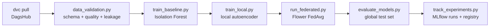
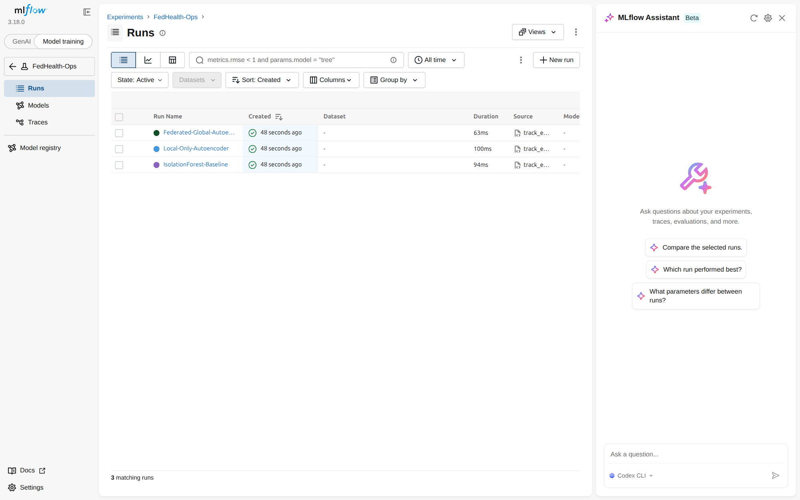
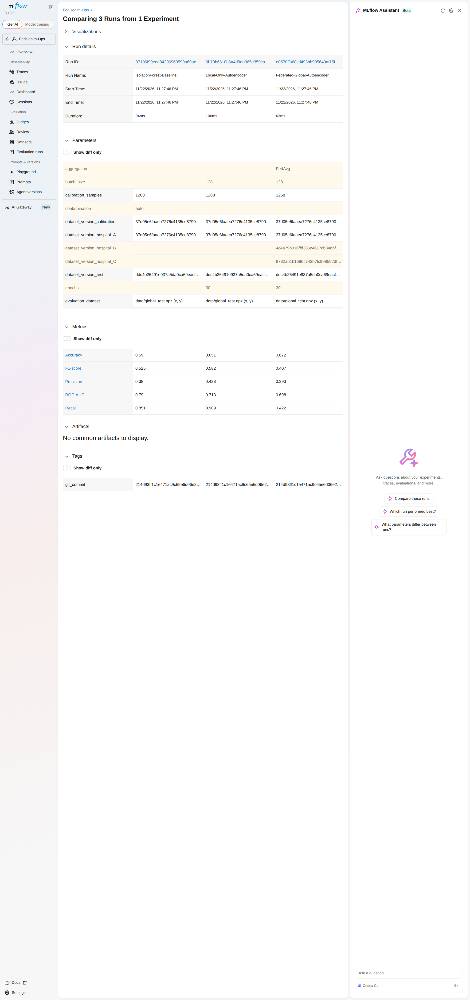
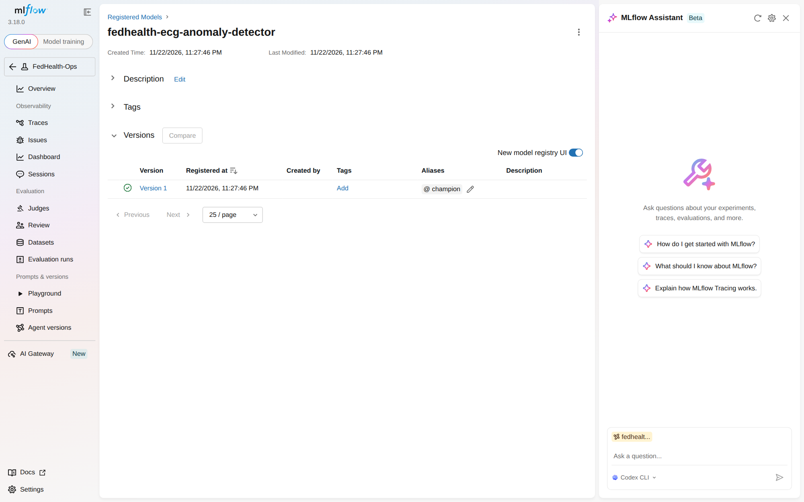
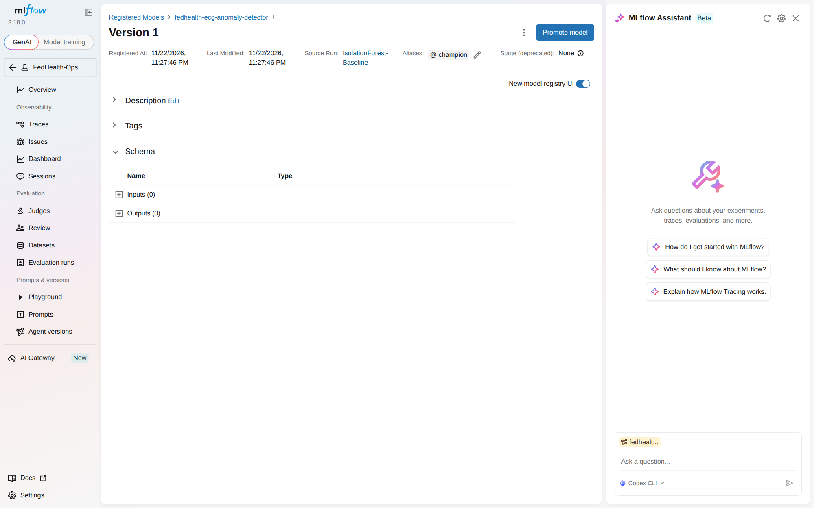
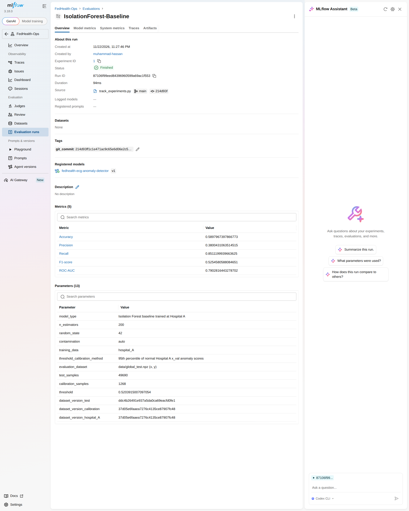

# FedHealth-Ops: Federated MLOps Pipeline for ECG Anomaly Detection

| Student | Roll Number |
| --- | --- |
| Saboor Sarfraz | 23L-0522 |
| Hassan Abaid | 23L-0584 |

Hospitals cannot share patient data, and a single hospital rarely has enough
of it. FedHealth-Ops trains an ECG anomaly detector across three simulated
hospitals with Flower federated learning. Only model weights leave a
hospital, never raw ECG data. The pipeline around the model is versioned,
validated, tracked and reproducible.

- **Data:** MIT-BIH Arrhythmia Database, 200-sample beats around each R-peak.
- **Primary model:** 1D convolutional autoencoder (PyTorch), trained on normal
  beats only; a high reconstruction error flags an anomaly.
- **Federated training:** Flower FedAvg, 3 hospital clients, 5 rounds.
- **Classical baseline:** Isolation Forest (scikit-learn).

## Pipeline



## 1. Versioned data and validation

- All datasets and model artifacts are tracked with DVC. The remote is
  DagsHub: <https://dagshub.com/MHassanAbaid24/fedhealth-ops>.
  - Config: [`.dvc/config`](.dvc/config)
  - Data pointers: [`data/*.npz.dvc`](data/)
  - Model pointers: [`outputs/*.dvc`](outputs/)
- [`data_validation.py`](data_validation.py) runs before any training and
  exits with an error on:
  - missing files or arrays, wrong shape (must be `(N, 200)`), empty arrays,
    non-float data;
  - NaN/Inf values and constant (flat-line) beats;
  - test labels outside `{0, 1}` or a missing class;
  - a patient record shared between hospitals (leakage).
- The training data loader calls the same checks, so corrupted inputs stop
  training before it starts.

```text
PASS hospital_A.npz: x_train=(11421, 200) x_val=(1268, 200)
PASS hospital_B.npz: x_train=(11447, 200) x_val=(1271, 200)
PASS hospital_C.npz: x_train=(11416, 200) x_val=(1268, 200)
PASS global_test.npz: x=(49690, 200) anomalies=13259
```

## 2. Leakage-free splits and baseline

- **Patient-disjoint split** (de Chazal DS1/DS2 protocol, in
  [`prepare_federated_mitbih.py`](prepare_federated_mitbih.py)):
  - Training patients (DS1) are split by record across hospitals A, B and C,
    so no patient appears in two hospitals.
  - The global test set uses only DS2 patients, never seen in training.
  - Thresholds are calibrated on normal Hospital A validation beats only. Test
    labels are used only for the final metrics.
- **Baseline first:** [`train_baseline.py`](train_baseline.py) fits an
  Isolation Forest before the autoencoders train. It is evaluated with the
  same threshold method and logged to MLflow next to them.

## 3. Experiment tracking and registry

[`track_experiments.py`](track_experiments.py) logs one MLflow run per model:

- **Hyperparameters:** epochs, batch size, learning rate, seed, federated
  rounds, aggregation strategy, Isolation Forest settings.
- **Dataset versions:** the DVC md5 of every dataset used, plus the git commit.
- **Metrics:** accuracy, precision, recall, F1-score, ROC-AUC.
- **Artifacts:** model file, confusion matrix, evaluation report.

The run with the best ROC-AUC is registered as
`fedhealth-ecg-anomaly-detector` with the alias `champion`.

### Results (49,690 test beats from unseen patients)

| Model | Accuracy | Precision | Recall | F1 | ROC-AUC |
| --- | --- | --- | --- | --- | --- |
| Isolation Forest baseline | 0.590 | 0.380 | 0.851 | 0.525 | **0.790** |
| Local-only autoencoder (Hospital A) | 0.651 | 0.428 | 0.909 | **0.582** | 0.713 |
| Federated autoencoder (FedAvg) | 0.672 | 0.393 | 0.422 | 0.407 | 0.698 |

Exported logs: [`docs/mlflow/mlflow_runs_export.csv`](docs/mlflow/mlflow_runs_export.csv),
[`docs/mlflow/registered_model.json`](docs/mlflow/registered_model.json).

### MLflow runs



### Parameters, dataset versions and metrics



### Registered model





### Baseline run detail



## 4. Reproduce with one command

Set up DagsHub credentials first (see [`DAGSHUB_SETUP.md`](DAGSHUB_SETUP.md)).
Put your token in an untracked `.env` file in the project root:

```bash
AWS_ACCESS_KEY_ID=<your-dagshub-token>
AWS_SECRET_ACCESS_KEY=<your-dagshub-token>
```

Then run either:

```bash
pip install -r requirements.txt
bash reproduce.sh
```

or with Docker:

```bash
docker compose --profile pipeline run --rm pipeline
```

[`reproduce.sh`](reproduce.sh) pulls the data and checkpoints, validates the
data, fits the baseline, evaluates all three models, and logs and registers
them in MLflow. The metrics match the table above exactly (about 1 minute).
Set `RETRAIN=1` to also retrain both autoencoders with fixed seeds (about 50
minutes on CPU).

View the runs afterwards:

```bash
mlflow ui --backend-store-uri sqlite:///mlflow.db --port 5000
```

## Guides

- [`DAGSHUB_SETUP.md`](DAGSHUB_SETUP.md): DagsHub remote, tokens, push and pull
- [`DVC_GUIDE.md`](DVC_GUIDE.md): data and model versioning
- [`MLFLOW_GUIDE.md`](MLFLOW_GUIDE.md): experiment tracking and registry
- [`DOCKER_GUIDE.md`](DOCKER_GUIDE.md): federated training and pipeline in Docker
- [`API_GUIDE.md`](API_GUIDE.md): FastAPI model serving
